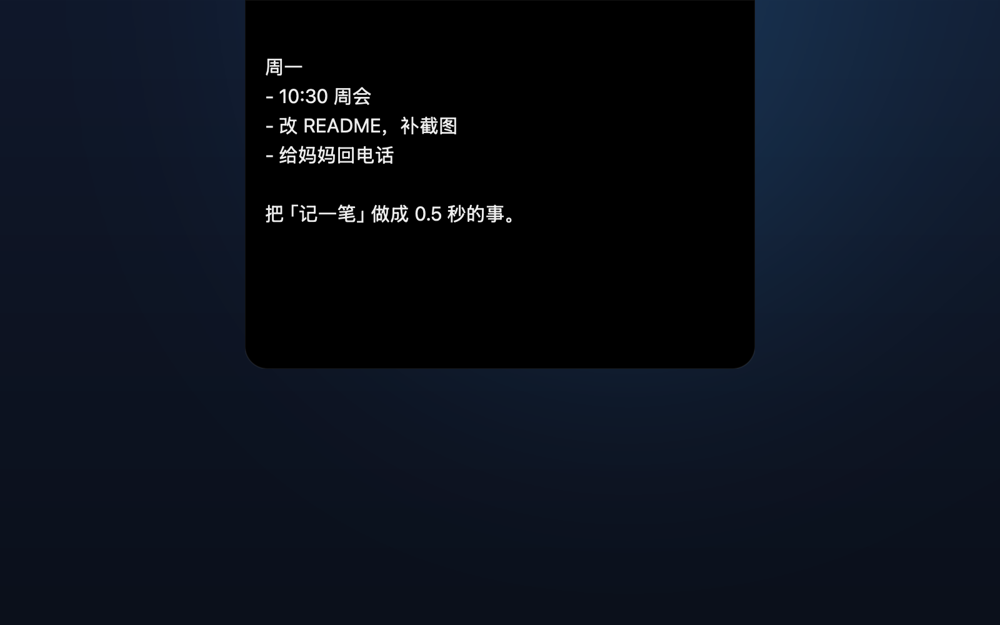

# NotchSlip

> 一个藏在 MacBook 刘海里的极简记事本。鼠标碰到刘海就展开，移开就收回。



## 为什么做这个

待办和临时念头，记在脑子里会丢，打开一个大而全的笔记应用又太重。
NotchSlip 把入口放在你视线本来就会扫到的位置：刘海。碰一下，写一句，移开，收起来。

## 特性

- **0.05 秒展开**：鼠标碰到刘海立即出现，移开 0.15 秒自动收回
- **每个桌面都在**：所有 Space 都能用，全屏 App 之上也能浮出来
- **点一下就能写**：纯文本、自动保存，没有账号、没有云
- **可以拉大小**：拖右下角改变尺寸，下次打开还是这个大小
- **极简到没有设置**：固定黑底白字，没有字体、颜色、待办框、Markdown 开关
- **零权限**：不需要辅助功能、屏幕录制，装上就能用
- `⌥Space` 全局唤出

## 安装

1. 到 [Releases](../../releases/latest) 下载 `NotchSlip-*.zip`
2. 解压，把 `NotchSlip.app` 拖进「应用程序」
3. 首次打开如果被 Gatekeeper 拦下（本地签名、未公证）：
   - 右键 App →「打开」→ 再点「打开」
   - 或 系统设置 → 隐私与安全性 →「仍要打开」
   - 或终端执行 `xattr -dr com.apple.quarantine /Applications/NotchSlip.app`

要求 macOS 14 或更新，Apple Silicon / Intel 通用二进制。

## 使用

| 操作 | 效果 |
| --- | --- |
| 鼠标碰到刘海 | 展开 |
| 点击文字区域 | 进入编辑 |
| 鼠标离开面板 | 0.15s 后收回（正在打字时等停手 1.5s） |
| `Esc` | 立即收起 |
| `⌥Space` | 唤出并聚焦 |
| 拖右下角 | 改大小 |
| 面板上右键 | 在 Finder 中显示笔记 / 开机启动 / 退出 |
| `⌘Q` | 退出（面板聚焦时） |
| 菜单栏铅笔图标 | 退出 / 开机启动 / 在 Finder 中显示笔记 |

> 退出有三种方式：**面板上右键 → 退出 NotchSlip**、在面板里按 **`⌘Q`**、或点菜单栏的铅笔图标。
> 菜单栏图标不是唯一入口——菜单栏太挤时 macOS 会把新图标排到刘海下面（物理遮挡），这时前两种方式照样可用。

## 数据

```
~/Library/Application Support/NotchSlip/notes.txt
```

纯文本，随时可以用任何编辑器打开。输入后 0.5s 自动保存，收起和退出时也会存一次。

## 从源码构建

不需要 Xcode，Command Line Tools 就够：

```bash
xcode-select --install    # 如果还没装
./scripts/build.sh        # 本机 arm64，产出 build/NotchSlip.app
./scripts/build-dist.sh   # 通用二进制 + dist/NotchSlip-<版本>.zip
```

## 实现要点

- `NSPanel` + `.canJoinAllSpaces` + `.fullScreenAuxiliary` + 窗口层级 26：压在菜单栏之上、每个桌面可见
- 刘海位置来自 `NSScreen.auxiliaryTopLeftArea/RightArea`，没有写死坐标
- 鼠标位置 30Hz 轮询 `NSEvent.mouseLocation`，**不需要辅助功能权限**
- 展开动画只改窗口高度，卡片尺寸固定，文字不会重排
- 纯 AppKit（`NSTextView`），中文输入法、撤销、选中等都是原生行为

## 已知限制

- 只对内置刘海屏做过适配；没有刘海时会在屏幕顶部中央模拟一块热区，能用但没有“从刘海长出来”的效果
- 单页纯文本，没有多标签 / Markdown / 待办框 / 字体设置（刻意不做）
- 展开时顶部黑条会盖住刘海右侧几个菜单栏图标，收起即恢复
- 菜单栏图标太多时，macOS 会把它排到刘海下方而看不见；退出请用面板右键菜单或 `⌘Q`
- 没有 iCloud 同步

## License

[MIT](LICENSE)